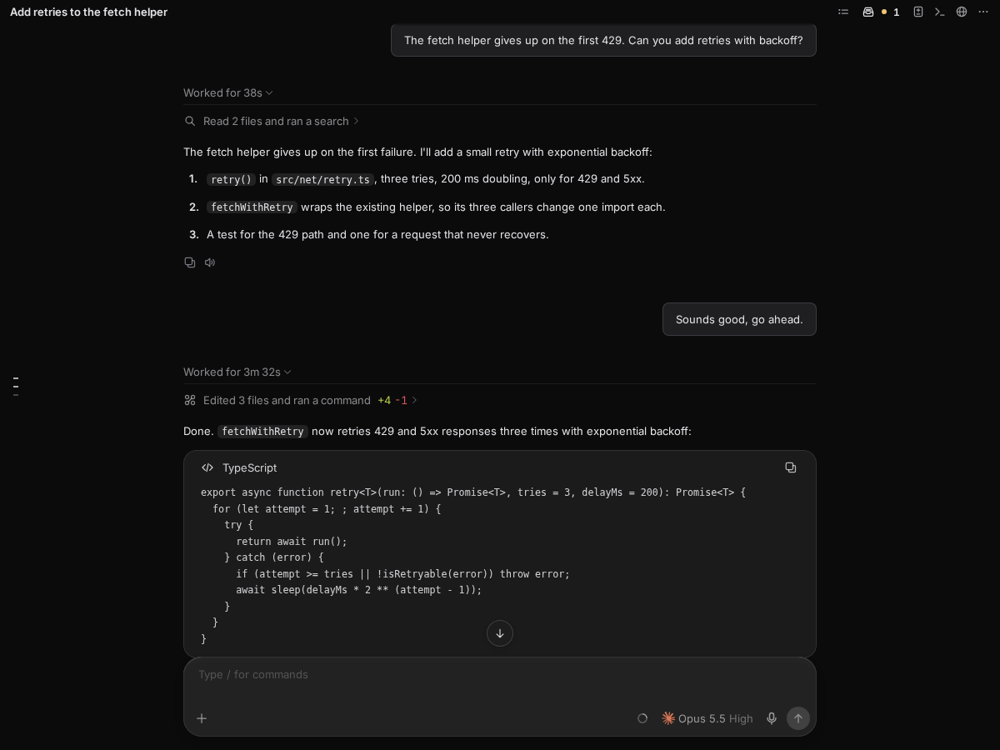

# Studio



A dense, near-black workbench for agent chats in cmux: quiet neutral chrome, a hairline between the
sidebar and the chat, compact rows, and a boxed prompt with square-ish corners.

Studio picks a near-black theme, but its chat stylesheet is made only from the theme's own colors,
so `agent-pane/theme.css` on its own reads over a light theme as well as a dark one (WCAG AA,
checked in both).

It is built only from public surfaces, so you can copy any part of it:

| File | What it does |
| --- | --- |
| `cmux-setup.json` | Picks the theme file; sets the chat's font, size and width and the sidebar's density and row facts |
| `themes/studio.json` | The colors, surfaces, borders and density |
| `agent-pane/theme.css` | The prompt bubble and cards, with `cmux.agentPane.style/1` tokens only |
| `customize/` | A terse hover card and plain sidebar rows with a dot while work runs |

```sh
cmux setup install github.com/manaflow-ai/cmux-studio-look
cmux setup remove manaflow-ai/studio-look
```

While it is installed, its `customize/` view stands in for your own sidebar view, if you have one;
`cmux setup remove` puts yours back.

How looks like this one are written: [look-addons.md](https://github.com/manaflow-ai/cmux/blob/639a429492936ae3b4f0d4a1e6d7fbf66e708520/docs/cmux-next/look-addons.md).
